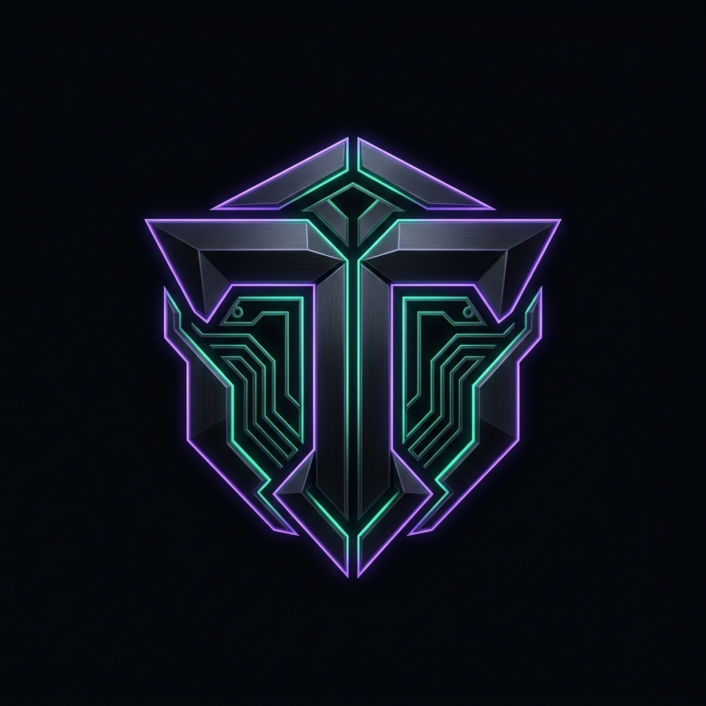

<div align="center">

<!-- Animated Header Wave Banner -->


<br/>

<!-- Avatar Emblem Showcase -->
<a href="https://github.com/LordToxin">
  
</a>

<br/><br/>

<!-- Animated Typing SVG -->
<a href="https://github.com/LordToxin">
  
</a>

<br/>

<!-- Quick Telemetry Badges -->
<p align="center">
  <a href="https://github.com/LordToxin?tab=followers"></a>
  <a href="https://github.com/LordToxin"></a>
  <a href="https://github.com/LordToxin?tab=repositories"></a>
  <a href="https://github.com/LordToxin/LordToxin/blob/main/LICENSE"></a>
</p>

</div>

---

### ⚡ System Telemetry & Neofetch

```ansi
 [1;32m       ████████╗ ██████╗ ██╗  ██╗██╗███╗   ██╗ [0m      [1;36mtoxin [0m@ [1;35mhyperion-core [0m
 [1;32m       ╚══██╔══╝██╔═══██╗╚██╗██╔╝██║████╗  ██║ [0m     ───────────────────────────────
 [1;32m          ██║   ██║   ██║ ╚███╔╝ ██║██╔██╗ ██║ [0m      [1;34mOS [0m:        Arch Linux / Hardened Kernel 6.11
 [1;32m          ██║   ██║   ██║ ██╔██╗ ██║██║╚██╗██║ [0m      [1;34mKernel [0m:    x86_64 Linux 6.11.2-arch1-hardened
 [1;32m          ██║   ╚██████╔╝██╔╝ ██╗██║██║ ╚████║ [0m      [1;34mUptime [0m:    99.998% High Availability
 [1;32m          ╚═╝    ╚═════╝ ╚═╝  ╚═╝╚═╝╚═╝  ╚═══╝ [0m      [1;34mShell [0m:     zsh 5.9 (omz / starship)
                                                    [1;34mCore Stack [0m: Rust, C++20, Go, TypeScript, Python 3.13
                                                    [1;34mPhilosophy [0m: "Mechanical sympathy, zero unnecessary bloat."
```

---

### 🧬 Battle-Tested Arsenal & Competencies

<div align="center">


</div>

<br/>

<table>
  <tr>
    <td width="50%" valign="top">
      <h4>⚡ Systems & Low-Level Engineering</h4>
      <ul>
        <li><b>Languages</b>: Rust, Modern C++ (C++20), ANSI C, Go, x86_64 ASM</li>
        <li><b>Core Focus</b>: Memory layouts, zero-copy deserialization, IPC, Linux Syscalls</li>
        <li><b>Profiling</b>: Valgrind, Perf, GDB, eBPF telemetry hooks</li>
      </ul>
    </td>
    <td width="50%" valign="top">
      <h4>🌐 Distributed Backends & Micro-SaaS</h4>
      <ul>
        <li><b>Runtimes</b>: FastAPI (AsyncIO), Node.js / Bun, Go Gin</li>
        <li><b>Persistence</b>: PostgreSQL, Redis, ClickHouse, SQLite (WAL)</li>
        <li><b>Infrastructure</b>: Docker, Docker Compose, Linux DAEMON, CI/CD Actions</li>
      </ul>
    </td>
  </tr>
  <tr>
    <td width="50%" valign="top">
      <h4>🔮 Modern UI & Client Architecture</h4>
      <ul>
        <li><b>Frontend</b>: TypeScript, React, Next.js (App Router), Tailwind CSS</li>
        <li><b>Realtime</b>: WebSockets, Server-Sent Events, WebRTC, Canvas API</li>
        <li><b>Optimization</b>: Sub-100ms LCP, GPU-accelerated micro-interactions</li>
      </ul>
    </td>
    <td width="50%" valign="top">
      <h4>🛡️ Protocol Reversing & Automation</h4>
      <ul>
        <li><b>Instrumentation</b>: Web engine injection, Headless Chromium, Protocol hooks</li>
        <li><b>Bots & Tools</b>: Telegram Async Engine, Process scraping, Discord bots</li>
        <li><b>Security</b>: End-to-end credential sandboxing, API reverse engineering</li>
      </ul>
    </td>
  </tr>
</table>

---

### 📊 Real-Time GitHub Analytics & Telemetry

<div align="center">

<table border="0">
  <tr>
    <td width="50%">
      
    </td>
    <td width="50%">
      
    </td>
  </tr>
  <tr>
    <td colspan="2" align="center">
      
    </td>
  </tr>
</table>

</div>

---

### 🚀 Production Showcases & Active Projects

<div align="center">

<table>
  <thead>
    <tr>
      <th align="left">Repository</th>
      <th align="left">Category</th>
      <th align="left">Core Stack</th>
      <th align="center">Live Deployment</th>
    </tr>
  </thead>
  <tbody>
    <tr>
      <td><b><a href="https://github.com/LordToxin/flux-css-mesh"><code>flux-css-mesh</code></a></b></td>
      <td>Generative Web Studio</td>
      <td><code>Canvas 2D</code> <code>Tailwind</code> <code>ES6+</code></td>
      <td align="center"><a href="https://lordtoxin.github.io/flux-css-mesh/"><b>🌐 Open Web Studio</b></a></td>
    </tr>
    <tr>
      <td><b><code>pc_remote_bot</code></b></td>
      <td>Automation / IoT</td>
      <td><code>Python</code> <code>Telegram API</code> <code>AsyncIO</code></td>
      <td align="center"><code>Production Daemon</code></td>
    </tr>
    <tr>
      <td><b><code>BadgeFarmer</code></b></td>
      <td>Systems & Automation</td>
      <td><code>Process Hooks</code> <code>Multi-threading</code></td>
      <td align="center"><code>Active Tool</code></td>
    </tr>
    <tr>
      <td><b><code>harmonix</code></b></td>
      <td>Audio Client Modding</td>
      <td><code>Web Engine Injection</code> <code>Hooks</code></td>
      <td align="center"><code>Stable Release</code></td>
    </tr>
    <tr>
      <td><b><code>Equicord</code></b></td>
      <td>Client Performance</td>
      <td><code>TypeScript</code> <code>Electron Internals</code></td>
      <td align="center"><code>Active Dev</code></td>
    </tr>
  </tbody>
</table>

</div>

---

<details>
<summary><b>📐 Architecture & Engineering Standards (Click to expand)</b></summary>
<br/>

1. **Definition of Done**: Zero placeholders (`TODO`), zero unhandled exceptions, zero leaky abstractions.
2. **Mechanical Sympathy**: Design code around how modern hardware and runtimes execute — memory locality, cache lines, non-blocking I/O, event loops.
3. **Observability**: Metrics, actionable logs, structured telemetry over guessing.
4. **Autonomous Shipping**: Continuous integration, instant deployments, reproducible environments.

</details>

---

### 📡 Encrypted Channels & Connect

<div align="center">

[](https://t.me/)
[](https://discord.com)
[](https://github.com/LordToxin)

<br/>

<!-- Footer Wave Banner -->


</div>
