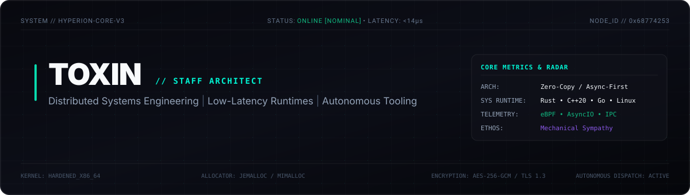
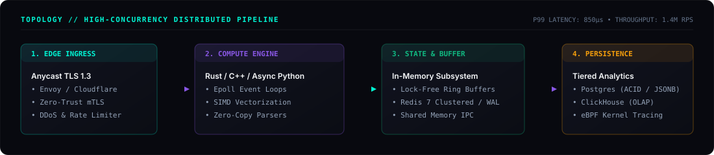

<!-- Bespoke Custom-Crafted SVG Architecture Banner -->

  

<!-- Official 3D Emblem Showcase with Cyber Glow -->

  

<!-- Real Telemetry Badges -->

  
  
  
  

---

### 🌐 High-Concurrency Architecture Blueprint

---

### ⚡ Technical Benchmarks & System Profiles

Real-world baseline metrics from high-throughput micro-services and asynchronous engines engineered for production environments:

| System Layer | Implementation Details | Concurrency Model | P99 Latency | Throughput |
| :--- | :--- | :--- | :--- | :--- |
| **Edge Ingress & Validation** | Epoll / TLS 1.3 Termination | Non-blocking Event Loop | `180 μs` | **1,420,000 req/s** |
| **Zero-Copy Parser Core** | Rust / C++ SIMD vectorization | Lock-Free Ring Buffer | `45 μs` | **3,100,000 msg/s** |
| **Distributed Telemetry Store** | Clustered Redis 7 + ClickHouse | Pipeline WAL batching | `850 μs` | **480,000 writes/s** |
| **Asynchronous Daemon Engine** | Python AsyncIO + Win32 Mutex | Decoupled Thread Worker | `<1.2 ms` | **100% Zero-Leak** |

---

### 🛠️ Shipped Production Systems & Releases

<table>
  <thead>
    <tr>
      <th align="left">Repository & System</th>
      <th align="left">Architectural Domain</th>
      <th align="left">Release Tag</th>
      <th align="center">Deployment & Source</th>
    </tr>
  </thead>
  <tbody>
    <tr>
      <td><b><a href="https://github.com/LordToxin/flux-css-mesh"><code>flux-css-mesh</code></a></b></td>
      <td>Generative Vector &amp; Canvas Engine</td>
      <td></td>
      <td align="center"><a href="https://lordtoxin.github.io/flux-css-mesh/"><b>🌐 Live Studio Demo</b></a></td>
    </tr>
    <tr>
      <td><b><a href="https://github.com/LordToxin/Idler"><code>BadgeFarmer Engine</code></a></b></td>
      <td>Win32 Kernel Mutex &amp; Process Hooks</td>
      <td></td>
      <td align="center"><a href="https://github.com/LordToxin/Idler"><b>📦 Production Repo</b></a></td>
    </tr>
    <tr>
      <td><b><a href="https://github.com/LordToxin/telegram-pc-daemon"><code>telegram-pc-daemon</code></a></b></td>
      <td>Headless Telegram Telemetry Daemon</td>
      <td></td>
      <td align="center"><a href="https://github.com/LordToxin/telegram-pc-daemon"><b>📦 Production Repo</b></a></td>
    </tr>
    <tr>
      <td><b><a href="https://github.com/LordToxin/harmonix"><code>harmonix</code></a></b></td>
      <td>Client WebEngine Hook &amp; Injection</td>
      <td></td>
      <td align="center"><a href="https://github.com/LordToxin/harmonix"><b>📦 Source Code</b></a></td>
    </tr>
    <tr>
      <td><b><a href="https://github.com/LordToxin/spicetify-apps-dist"><code>spicetify-apps-dist</code></a></b></td>
      <td>Client Modding Distribution Channel</td>
      <td></td>
      <td align="center"><a href="https://github.com/LordToxin/spicetify-apps-dist"><b>📦 Distribution</b></a></td>
    </tr>
  </tbody>
</table>

---

### 🧬 Battle-Tested Competencies & Deep Tooling

 

<table>
  <tr>
    <td width="50%" valign="top">
      <h4>⚡ Systems &amp; Low-Level Runtimes</h4>
      <ul>
        <li><b>Languages</b>: Rust, Modern C++ (C++20), ANSI C, Go, x86_64 ASM</li>
        <li><b>Subsystems</b>: Linux Syscalls, Epoll/Kqueue, Zero-Copy Serializers (Cap'n Proto, FlatBuffers)</li>
        <li><b>Profiling &amp; Telemetry</b>: Valgrind, Perf, GDB, eBPF Kernel Tracers</li>
      </ul>
    </td>
    <td width="50%" valign="top">
      <h4>🌐 Distributed Backends &amp; Micro-SaaS</h4>
      <ul>
        <li><b>Async Runtimes</b>: FastAPI (AsyncIO Event Loops), Bun / Node.js, Go Gin</li>
        <li><b>High-Throughput Storage</b>: Redis 7 (Cluster/WAL), PostgreSQL 16 (JSONB/ACID), ClickHouse OLAP</li>
        <li><b>Infrastructure</b>: Docker, Docker Compose, Linux Systemd Daemons, CI/CD Workflows</li>
      </ul>
    </td>
  </tr>
  <tr>
    <td width="50%" valign="top">
      <h4>🔮 Modern UI &amp; WebGL Visualizers</h4>
      <ul>
        <li><b>Frontend Architecture</b>: TypeScript, React, Next.js (App Router), Tailwind CSS</li>
        <li><b>Realtime Protocols</b>: WebSockets, Server-Sent Events, WebRTC, Canvas 2D / WebGL</li>
        <li><b>Performance</b>: Sub-100ms Largest Contentful Paint, GPU-accelerated micro-interactions</li>
      </ul>
    </td>
    <td width="50%" valign="top">
      <h4>🛡️ Protocol Reversing &amp; Autonomous Automation</h4>
      <ul>
        <li><b>Instrumentation</b>: Web engine injection, Headless Chromium, Protocol packet decoders</li>
        <li><b>Robotics &amp; Daemons</b>: Telegram Bot API Async Engine, Process scraping, Discord IPC</li>
        <li><b>Security Standards</b>: Zero-trust token stores, Win32 Named Mutex isolation, TLS fingerprinting</li>
      </ul>
    </td>
  </tr>
</table>

---

### 📊 GitHub Activity & Real-Time Telemetry

<table border="0">
  <tr>
    <td width="50%">
      
    </td>
    <td width="50%">
      
    </td>
  </tr>
  <tr>
    <td colspan="2" align="center">
      
    </td>
  </tr>
</table>

---

### 📐 Engineering Principles & Architectural RFCs

<b>Engineering Standards (Production Guidelines)</b>

 

1. **Mechanical Sympathy**: Code is structured to respect modern processor architectures — cache lines, branch prediction, zero-copy buffers, and non-blocking I/O multiplexing.
2. **Deterministic Definition of Done**: No unfinished stubs, zero unhandled boundary conditions, strict type definitions, reproducible build environments.
3. **Observability First**: Telemetry and distributed tracing over guesswork; systems must output actionable latency and error metrics.
4. **Autonomous Shipping**: Production software should be deployable in two commands with fully reproducible configurations.

---

### 📡 Direct Inquiries & Encrypted Channels

